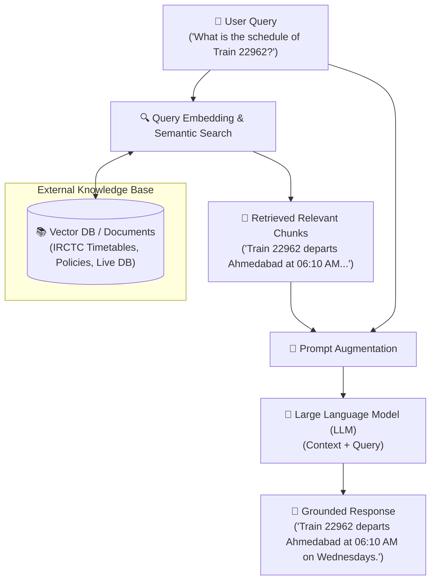

# Task 3: Basic RAG Workflow Diagram

## Flowchart Representation

---

## Detailed Step-by-Step Breakdown

1. **User Query:** The user inputs an arbitrary natural language question into the interface.
2. **Retrieve Documents:** The query is converted into an embedding vector, and a similarity search is performed against a vector database storing indexed documents, reports, or records.
3. **Combine with LLM (Augmentation):** The top matching document chunks are combined with the user query into a structured prompt template.
4. **Generate Answer:** The LLM reads both the query and the exact retrieved reference facts to produce a strictly grounded, hallucination-free answer.
